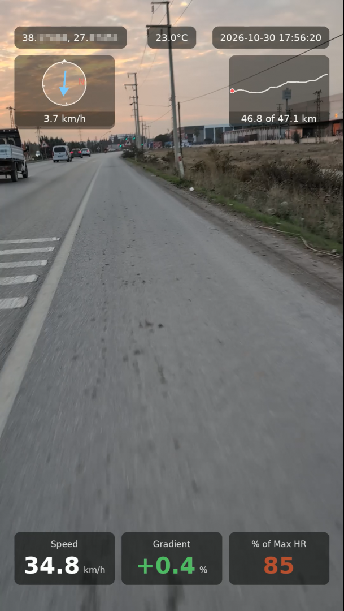

# ot.py

Burns ride telemetry from a TCX file onto a video: speed (or pace), gradient,
heart rate, a route minimap with distance, coordinates, timestamp, temperature
and a wind compass. The overlay is rendered as an alpha-channel video and
composited onto your footage with ffmpeg; the audio is copied untouched.



## Requirements

- Python 3.9 or newer
- `ffmpeg` and `ffprobe` on `PATH`
- Pillow: `pip install pillow`
- Optional: `timezonefinder` (`pip install timezonefinder`) to auto-detect the
  timezone from the track. Without it, pass `--tz-name` or `--tz-offset`.
- DejaVu fonts at `/usr/share/fonts/truetype/dejavu/` (`DejaVuSans.ttf` and
  `DejaVuSans-Bold.ttf`)
- Internet access for the wind box (Open-Meteo, no API key). Use `--wind off`
  to work offline.

If a VAAPI device is available, the final encode uses `h264_vaapi`; otherwise
ffmpeg's software encoder is used.

## Quick start

```fish
python3 overlay_telemetry3.py --video PXL_20261029_171908000.mp4 --tcx activity.tcx
```

The result is written next to the video as `<video>_overlay.mp4`. Use
`--output` to choose another path.

```fish
python3 overlay_telemetry3.py --video PXL_20261029_171908000.mp4 \
    --tcx activity.tcx --tz-name Europe/Istanbul --speed-type pace --max-hr 190
```

## How the video is matched to the track

The video's start time is read from its **filename**, in the Pixel style
`PXL_YYYYMMDD_HHMMSSmmm.mp4` (the script looks for `YYYYMMDD_HHMMSSmmm`
anywhere in the name). The video file's own metadata is not used for the start
time (only for size, frame rate, duration and rotation).

Some phones stamp that filename in UTC rather than local time, so the script
tries both readings and picks the one that falls inside the TCX track's time
range. If both fit, it assumes UTC. If neither fits, it warns and assumes local
time. Force a reading with `--tz-name` / `--tz-offset`, and nudge the sync with
`--gps-offset` (seconds; positive values show later telemetry).

All times shown on the overlay are in the resolved local timezone.

## Input data

A TCX file with `Trackpoint` entries that have a time and a position. The
script also uses these when present:

| Field | Used for |
|---|---|
| `AltitudeMeters` | gradient |
| `DistanceMeters` | distance, minimap "x of y km", gradient |
| `Speed` (extension) | speed or pace (GPS-derived speed is used if absent) |
| Heart rate `Value` | heart-rate panel |
| `Temperature` / `Temp` / `atemp` | temperature box (omitted if absent) |

Telemetry is sampled at the latest recorded point at or before each frame's
time. Use `--smooth-window` to average speed and gradient over a time window.

## Options

`--video` is the only option that is never read from the config file.

| Option | Default | Description |
|---|---|---|
| `--video FILE` | required | Source video |
| `--tcx FILE` | required | TCX activity file |
| `--output FILE` | `<video>_overlay<ext>` | Output video |
| `--config PATH` | `ot.conf` in the script's directory | Config file (see below) |
| `--save-config` | off | Rewrite the config file from the current effective parameters |
| `--tz-offset H` | auto | Hours to add to UTC (for example `3`). Overrides `--tz-name` |
| `--tz-name NAME` | auto | IANA timezone (for example `Europe/Istanbul`) |
| `--gps-offset S` | `0` | Shift telemetry relative to the video, in seconds |
| `--overlay-fps N` | `5` | Frame rate the overlay is rendered at |
| `--smooth-window S` | `0` | Smoothing window for speed and gradient, in seconds (0 = off) |
| `--keep-temp` / `--no-keep-temp` | off | Keep the temporary overlay frames and video |
| `--speed on\|off` | on | Speed panel |
| `--grade on\|off` | on | Gradient panel |
| `--heartrate on\|off` | on | Heart-rate panel |
| `--minimap on\|off` | on | Route minimap with distance |
| `--latlong on\|off` | on | Coordinates readout |
| `--timestamp on\|off` | on | Date and time readout |
| `--speed-type speed\|pace` | `speed` | km/h or min:sec per km |
| `--max-hr BPM` | none | Show heart rate as a percentage of this maximum instead of raw bpm |
| `--wind on\|off` | on | Wind compass |
| `--wind-source auto\|archive\|forecast` | `auto` | Weather data source (see below) |
| `--wind-points N` | `3` | Locations along the video's part of the track to fetch wind for |
| `--wind-arrow to\|from` | `to` | Arrow points where the wind blows **to**, or where it comes **from** |
| `--wind-up heading\|north` | `heading` | What points up on the compass: your direction of travel, or true north |

# ot.conf

Every option except `--video` can be kept in a config file so the command line
stays short.

- **Location:** `ot.conf` in the same directory as the script
  (not the video's directory, and not the current directory). Use
  `--config PATH` to use a different file.
- **First run:** if the file doesn't exist, it is created from the parameters
  of that run.
- **Later runs:** the file is read, and anything on the command line overrides
  it. `--save-config` rewrites it from the current effective parameters.
- **Format:** one `key = value` per line, using the option names without the
  leading `--`. A blank value means the built-in default. Lines starting with
  `#` are comments.
- **Other values:** under each active line, the other possible values appear as
  commented-out lines. Move the `#` to switch.

```
# Where the wind comes from: 'archive' (ERA5 reanalysis), ...
wind-source = auto
# wind-source = archive
# wind-source = forecast
```

`tcx` and `output` are stored too. Because the file is shared by every ride,
either leave them blank and pass `--tcx` each time, or expect that value to
apply to every run until you change it. The command line always wins.

## Wind

The wind box shows an arrow in a compass circle, with the wind speed below. The
data is hourly 10 m wind from [Open-Meteo](https://open-meteo.com/), interpolated
between hours for each frame.

- **`--wind-source`**
  - `archive`: ERA5 reanalysis.
  - `forecast`: the forecast API's data for past days (recent history only).
  - `auto`: use the archive when it fully covers the video, otherwise the
    forecast. ERA5 lags real time by days, so very recent rides normally fall
    back to the forecast.
- **`--wind-points`**: the script picks up to N spots along the part of the track
  the video covers and fetches them in one request. At each frame the wind is
  blended from those spots by distance to your GPS position. Spots closer than
  1 km are merged, so a short clip normally uses a single location.
- **Arrow direction:** Open-Meteo reports where the wind comes **from**. By
  default the arrow points where it blows **to** (`--wind-arrow to`).
- **Compass orientation:** with `--wind-up heading`, up is your direction of
  travel, so a tailwind points up, a headwind points down, and a wind from your
  left points right. With `--wind-up north`, up is north.
- **Log output:** each run prints which source was used, the locations, and the
  wind and route heading at the start and end of the video. Check that against
  what you remember if the arrow looks wrong.

Treat the numbers as modelled, not measured at your position. The two sources
can disagree noticeably in light wind. If the overlay doesn't match what you
felt on the road, try the other `--wind-source`. If the weather request fails,
the script warns and renders the video without the wind box.

## Troubleshooting

| Symptom | What to check |
|---|---|
| `Could not parse a YYYYMMDD_HHMMSSmmm timestamp` | The filename needs a Pixel-style timestamp. Rename the file or add one. |
| `timezonefinder is not installed` | `pip install timezonefinder`, or pass `--tz-name` / `--tz-offset`. |
| Warning that the video start is outside the TCX range | Wrong video and track pairing, or wrong timezone reading. Try `--tz-name` or `--tz-offset`. |
| Telemetry runs ahead of or behind the video | Adjust `--gps-offset` (seconds). |
| No temperature box | The TCX has no temperature data. |
| No wind box | `--wind off` is set, or the Open-Meteo request failed (see the warning in the log). |
| Overlay looks sideways | Rotation metadata is handled automatically; check `ffprobe` output for the source file if it still looks wrong. |

# fit2tcx.py

Convert a Garmin .fit activity file to a .tcx file, keeping every value the TCX format can carry, plus temperature (and optionally any other per-record field) in <Extensions>.

Usage:
    python3 fit2tcx.py input.fit [output.tcx] [--all-fields]

    --all-fields   also dump every remaining record field (including
                   "unknown_*" ones) as <fit:Field name="...">value</fit:Field>
                   inside each trackpoint's <Extensions>.

Requires: pip install fitparse

Notes:
  * TCX has no native temperature element. Temperature is written as
    <gpxtpx:atemp> (Garmin TrackPointExtension v1, in degrees C) inside
    each Trackpoint's <Extensions>. Tools that don't know it ignore it.
  * Positions are converted from FIT semicircles to decimal degrees.
  * enhanced_speed / enhanced_altitude are preferred over the plain fields.